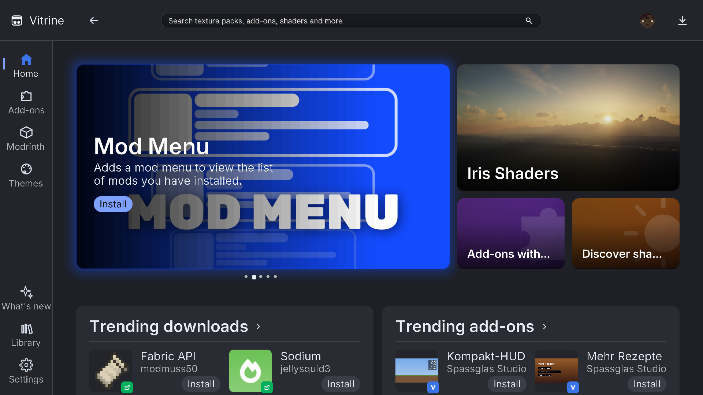
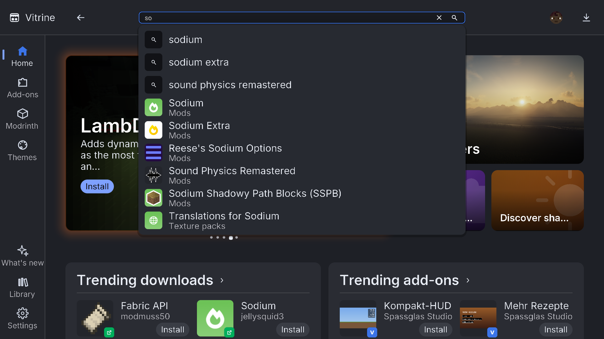
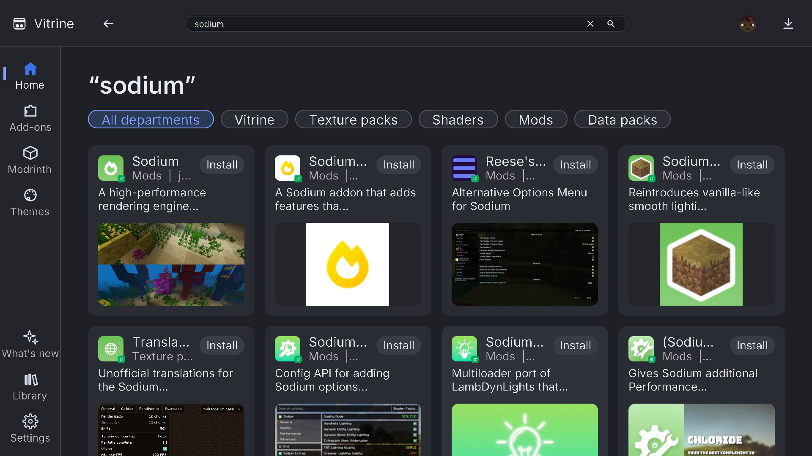
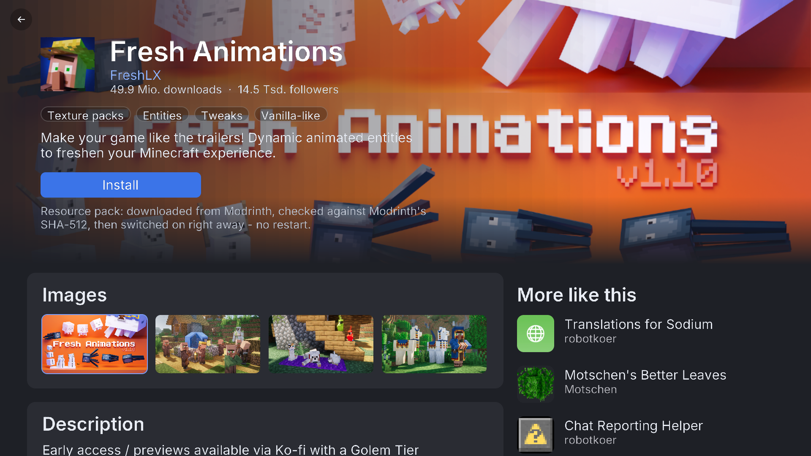
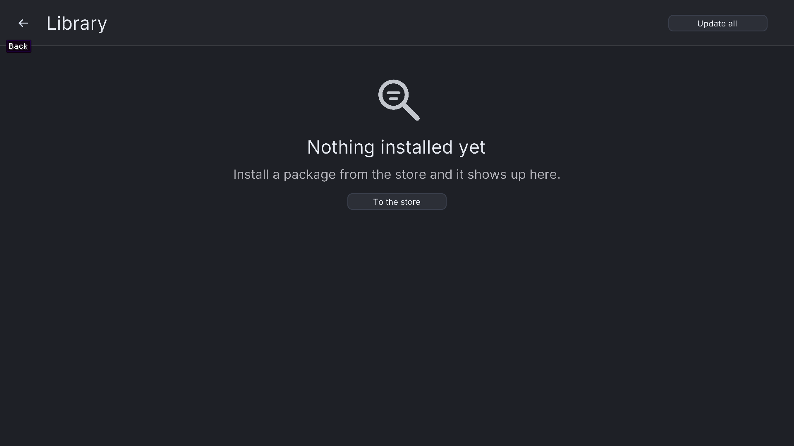
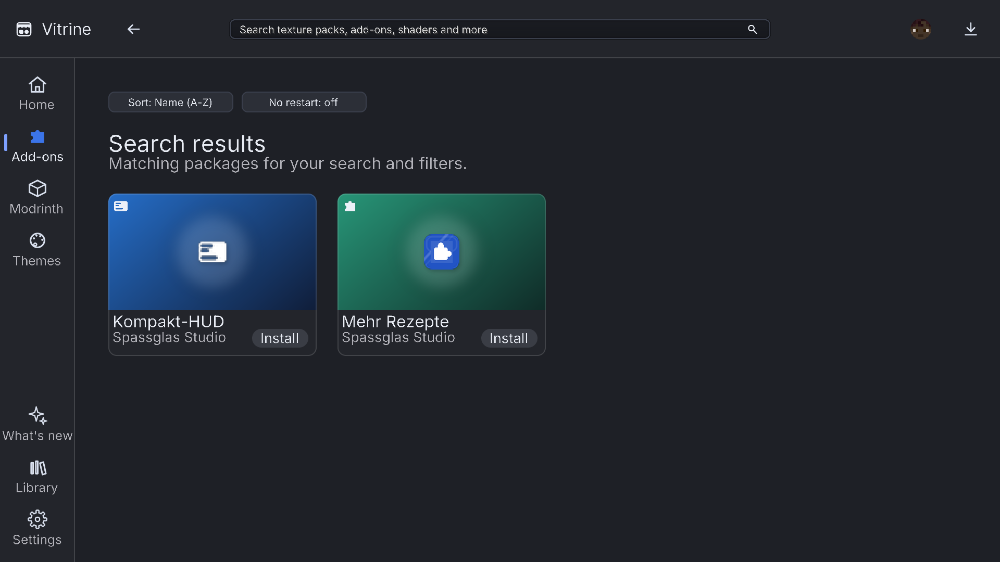
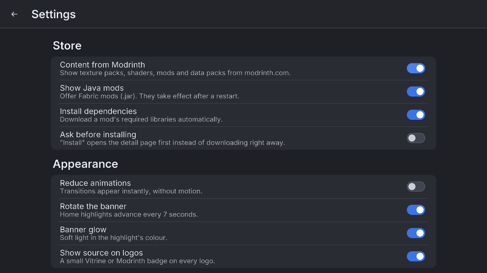

<p align="center">
  
</p>

<h1 align="center">Vitrine</h1>

<p align="center">
  <b>A free store inside Minecraft.</b><br>
  Texture packs, shaders, themes, HUD modules, sounds, languages, data packs, Lua/JavaScript add-ons and the whole Modrinth catalog,
  one click away, most of it <b>without a restart</b>.
</p>

<p align="center">
  <a href="https://modrinth.com/mod/vitrine-store">Modrinth</a> ·
  <a href="docs/guide/install.md">Install</a> ·
  <a href="docs/guide/addons.md">Build add-ons</a> ·
  <a href="docs/guide/themes.md">Themes</a> ·
  <a href="docs/guide/faq.md">FAQ</a>
</p>



## Features

- **An app store in your game.** Press `M` (or the button on the title screen)
  and browse a home page with a featured banner, trending lists, shelves and
  collections, laid out like a modern desktop store.
- **Hot apply.** Texture packs, shaders, themes, HUD modules, sounds, languages
  and data packs take effect immediately. No restart, no world reload.
- **Modrinth built in.** Search all resource packs, shaders, data packs and
  Fabric mods on Modrinth with live suggestions. Downloads are verified against
  Modrinth's SHA-512 hashes, and required dependencies are installed for you.
- **Add-ons in Lua and JavaScript.** Write real gameplay features, HUDs, menus
  and screen filters as small scripts. They load and unload live, run in a
  sandbox and need no restart. [Guide →](docs/guide/addons.md)
- **Themes.** Restyle the store itself with a simple token file.
  [Guide →](docs/guide/themes.md)
- **Library.** See everything you installed, switch it on and off, set the
  load order, update with one click.
- **HUD editor.** Drag HUD widgets where you want them.
- **Safe by default.** Every package is checked before it is applied (zip slip,
  zip bombs, file types, image sizes, SHA-256, Ed25519 signature). Packages get
  only the permissions they declare and you approve. Broken packages roll back
  automatically. [Details →](docs/guide/security.md)
- **Free.** No prices, no coins, no ads, no account. Open source under
  Apache-2.0.
- **15 languages:** English, Deutsch, Français, Español, Italiano, Português
  (Brasil), Nederlands, Polski, Svenska, Türkçe, Русский, Українська, 日本語,
  한국어, 简体中文.

## Screenshots

| | |
|---|---|
|  |  |
| Search with live suggestions | Search results |
|  |  |
| Product page | Library |
|  |  |
| Add-ons | Settings |

## Quick start

1. Install [Fabric Loader](https://fabricmc.net/use/) for your Minecraft version.
2. Put [Fabric API](https://modrinth.com/mod/fabric-api) and the matching Vitrine jar into
   `.minecraft/mods/`.
3. Start the game and press **`M`**.

Detailed steps: [docs/guide/install.md](docs/guide/install.md)

## Make your own content

| I want to … | Guide |
|---|---|
| write an add-on in Lua or JavaScript | [addons.md](docs/guide/addons.md) |
| make a theme for the store | [themes.md](docs/guide/themes.md) |
| make a texture, HUD, sound or language package | [packages.md](docs/guide/packages.md) |
| use the visual designer or the command line | [designer-and-cli.md](docs/guide/designer-and-cli.md) |
| publish my package in the catalog | [packages.md#publishing](docs/guide/packages.md#publishing) |
| understand the security model | [security.md](docs/guide/security.md) |

## Repository layout

```
mod/          the Fabric mod (Java 21)
designer/     Vitrine Designer, a static web page for building packages
cli/          command-line tool: init, validate, pack, sign, publish
registry/     JSON schemas and the catalog format
templates/    template repository for package authors
scripts/      build helpers (translations, example add-ons, assets)
docs/         guides and images
```

## Building

JDK 21 is required.

```
cd mod
./gradlew build
```

Tests: `./gradlew test`. Start a dev client: `./gradlew runClient`.

## Supported versions

Minecraft **1.21.1, 1.21.4, 1.21.5, 1.21.8, 1.21.10 and 1.21.11** (Fabric). Each version has its own jar on
Modrinth. Releases before 1.14 cannot run
Fabric, so they are out of scope.

## Contributing

Bug reports, translations and pull requests are welcome. See
[CONTRIBUTING.md](CONTRIBUTING.md).

## License

Code and UI graphics: **Apache-2.0**, see [LICENSE](LICENSE). Third-party
components and their licenses are listed in [THIRD-PARTY.md](THIRD-PARTY.md).

---

NOT AN OFFICIAL MINECRAFT PRODUCT. NOT APPROVED BY OR ASSOCIATED WITH MOJANG OR
MICROSOFT. Vitrine is not affiliated with Modrinth.
